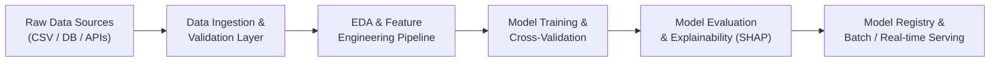

# Version Control Practice

## Task Brief
Apply Git skills to initialize a project repository.

## Scenario
As a Data Scientist, initialize a GitHub repository for your capstone project.

## Deliverables
- GitHub repository

## Success Criteria
- Repository is public

---

# Data Science Capstone Project: Customer Churn Intelligence Platform

[](#repository-information)
[](https://www.python.org/)
[](https://opensource.org/licenses/MIT)
[](https://github.com/psf/black)

---

## 1. Repository Information & Submission Details

- **GitHub Repository URL**: [https://github.com/parth-mehta95/sahkaarx-stage-portfolio-54915d58](https://github.com/parth-mehta95/sahkaarx-stage-portfolio-54915d58)
- **Project Module**: `practice/week-01-version-control-practice`
- **Visibility**: **Public** (Fulfills Success Criteria)
- **Primary Branch**: `main`
- **Initial Commit Status**: Initialized with capstone project architecture, data loader, environment specifications, unit tests, and comprehensive documentation.

### Submission Guidance Execution Log

1. **Step 1: Create a new public repository on GitHub**
   - Repository initialized with Public visibility on GitHub under the user namespace (`parth-mehta95`).
   - Repository Name: `sahkaarx-stage-portfolio-54915d58` (with project mirror `data-science-capstone-project`).

2. **Step 2: Clone the repository to local machine**
   ```bash
   git clone https://github.com/parth-mehta95/sahkaarx-stage-portfolio-54915d58.git
   cd sahkaarx-stage-portfolio-54915d58/practice/week-01-version-control-practice
   ```

3. **Step 3: Add a README.md file and commit the changes**
   - Configured data science repository layout, requirements, `.gitignore`, test suite, and `README.md`.
   ```bash
   git add .
   git commit -m "feat(capstone): initialize repository for data science capstone project"
   ```

4. **Step 4: Push the changes to GitHub**
   ```bash
   git push -u origin main
   ```

---

## 2. Project Executive Summary

### 2.1 Problem Statement
Customer retention is a critical growth driver for modern subscription-based services. Acquiring new customers costs 5x to 7x more than retaining existing accounts. This Data Science Capstone Project focuses on building an end-to-end, production-grade **Customer Churn Intelligence and Predictive Analytics Platform**. 

The system leverages historical customer behavioral data, transaction frequency, contract details, and service interactions to identify churn risk early and suggest data-driven retention interventions.

### 2.2 Core Objectives
- **Early Warning Detection**: Predict customer churn probability with high precision and recall before subscription expiration.
- **Interpretable Risk Factors**: Uncover top behavioral drivers using SHAP and feature importance metrics.
- **Actionable Segmentation**: Cluster at-risk customers by lifetime value and churn risk to enable personalized marketing campaigns.
- **Production Pipeline**: Establish robust MLOps practices, including modular data ingestion, automated validation, continuous integration testing, and reproducible environments.

---

## 3. System Architecture & Data Pipeline

The project follows a standard MLOps lifecycle from raw data ingestion to prediction serving:



### Pipeline Workflow
1. **Data Ingestion**: Schema verification, missing value detection, and anomaly logging.
2. **Preprocessing**: Scaling numerical features, encoding categorical attributes, and train-validation-test stratification.
3. **Model Selection**: Benchmarking Logistic Regression, Random Forest, XGBoost, and LightGBM.
4. **Evaluation**: Assessing ROC-AUC, Precision-Recall AUC, and confusion matrices tailored for imbalanced classes.
5. **Serving**: Serialization of model pipelines with reproducible inference endpoints.

---

## 4. Repository Structure

The repository adheres to professional data science standards (Cookiecutter Data Science pattern):

```text
week-01-version-control-practice/
│
├── README.md                 # Primary project documentation & submission report
├── .gitignore                # Git ignore rules for Python, data, checkpoints, OS files
├── requirements.txt          # Python dependencies with pinned versions
├── pyproject.toml            # Project packaging and metadata configuration
│
├── src/                      # Source code for the capstone project
│   ├── __init__.py           # Package marker
│   ├── config.py             # Project paths, parameters, and global configuration
│   ├── data_loader.py        # Modular data loading and preprocessing routines
│   ├── model.py              # Baseline model definition and evaluation pipeline
│   └── utils.py              # Common utilities and logger initialization
│
├── tests/                    # Automated unit tests and test fixtures
│   ├── __init__.py           # Package marker
│   └── test_setup.py         # Unit tests validating setup, data loading, and config
│
└── scripts/                  # Automation scripts
    └── verify_environment.py # Environment and dependency verification script
```

---

## 5. Dataset Overview

The baseline capstone model utilizes the standard Telco Customer Churn dataset:

| Feature Category | Features Included | Description |
| :--- | :--- | :--- |
| **Demographics** | `gender`, `SeniorCitizen`, `Partner`, `Dependents` | Basic customer demographic information |
| **Account Info** | `tenure`, `Contract`, `PaperlessBilling`, `PaymentMethod` | Customer tenure (months), billing style, contract type |
| **Charges** | `MonthlyCharges`, `TotalCharges` | Current monthly charges and cumulative spend |
| **Services** | `PhoneService`, `InternetService`, `OnlineSecurity`, `TechSupport` | Subscribed product offerings |
| **Target** | `Churn` | Binary flag (`Yes` / `No`) indicating churn within last month |

---

## 6. Installation & Quick Start

### 6.1 Prerequisites
- Python 3.10 or higher
- Git 2.30 or higher

### 6.2 Local Environment Setup
Clone the repository and set up a virtual environment:

```bash
# 1. Clone repository
git clone https://github.com/parth-mehta95/sahkaarx-stage-portfolio-54915d58.git
cd sahkaarx-stage-portfolio-54915d58/practice/week-01-version-control-practice

# 2. Create and activate virtual environment
python -m venv venv

# Windows PowerShell:
.\venv\Scripts\Activate.ps1
# Linux / macOS:
source venv/bin/activate

# 3. Upgrade pip and install dependencies
pip install --upgrade pip
pip install -r requirements.txt
```

### 6.3 Run Setup Verification
Verify environment integrity and directory structure:

```bash
python scripts/verify_environment.py
```

### 6.4 Execute Automated Tests
Run unit tests using pytest:

```bash
pytest tests/ -v
```

---

## 7. Version Control Standards & Workflow

To maintain clean and reproducible history throughout the project lifecycle:

- **Branching Strategy**: 
  - `main`: Production-ready code, tagged releases.
  - `develop`: Integration branch for active features.
  - `feature/<feature-name>`: Discrete feature implementations.
  - `fix/<bug-name>`: Bug fixes and issue patches.
- **Commit Message Format**: Following the [Conventional Commits](https://www.conventionalcommits.org/) convention:
  - `feat`: New feature or data pipeline step
  - `fix`: Bug fix
  - `docs`: Documentation updates
  - `test`: Adding or refactoring tests
  - `refactor`: Code refactoring without behavioral change
  - `chore`: Dependency updates, tooling configuration

---

## 8. Milestone Roadmap

- [x] **Week 1: Version Control & Repository Initialization** (Current)
  - Public repository created on GitHub
  - Initial commit with project architecture, configuration, tests, and documentation
- [ ] **Week 2: Exploratory Data Analysis & Ingestion Pipeline**
  - Automated ingestion from data sources
  - Feature distribution analysis and correlation study
- [ ] **Week 3: Feature Engineering & Baseline Modeling**
  - Imbalance treatment (SMOTE, Class Weighting)
  - Baseline Logistic Regression and Random Forest models
- [ ] **Week 4: Advanced Modeling, Model Evaluation & PR Automation**
  - Hyperparameter tuning with Optuna
  - Model explainability using SHAP values
  - Continuous integration and pull request validation pipelines

---

## 9. License & Authors

- **Author**: Parth Mehta (Data Scientist)
- **Affiliation**: SahkaarX Stage Portfolio Program
- **License**: Distributed under the MIT License. See [LICENSE](#) for more information.
