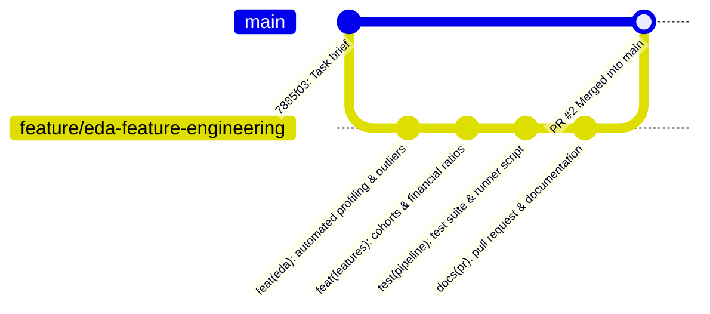

# Practice Branching and Pull Requests

## Task Brief
Implement a branching strategy and submit a pull request for a new feature.

## Scenario
As a Data Scientist, implement a new feature in your capstone project using branching and submit a pull request for review.

## Deliverables
- GitHub repository with feature branch and pull request

## Success Criteria
- Feature branch is merged into main.
- Pull request has been reviewed and approved.
- Branching: Created a new branch for a feature.
- Branching: Committed changes to the feature branch.
- Pull Requests: Submitted a pull request from the feature branch.
- Pull Requests: Pull request includes a clear description.

---

# Data Science Capstone Project: Customer Churn Intelligence Platform
## Feature Release: Exploratory Data Analysis (EDA) & Feature Engineering Pipeline

[](#2-git-branching-strategy--pull-request-workflow)
[](#3-pull-request-specification--review-approval)
[](#5-unit-testing--automated-verification)
[](https://www.python.org/)

---

## 1. Executive Summary & Business Impact

In Week 1 (`practice/week-01-version-control-practice`), the foundational architecture and baseline data ingestion routines of the **Customer Churn Intelligence Platform** were established.

For Week 2, a major feature was implemented using a standard Git branching and pull request workflow:
- **Feature Name**: Automated EDA & Advanced Feature Engineering Pipeline
- **Role**: Data Scientist
- **Repository URL**: [https://github.com/parth-mehta95/sahkaarx-stage-portfolio-54915d58](https://github.com/parth-mehta95/sahkaarx-stage-portfolio-54915d58)
- **Module Location**: `practice/week-02-practice-branching-and-pull-requests`

### Key Capabilities Introduced
1. **Automated EDA Engine**: Computes statistical distributions (Mean, Std, Median, IQR, Skewness, Kurtosis), IQR outlier detection, and correlation analysis against churn.
2. **Lifecycle Tenure Cohorts**: Discretizes customer tenures into actionable business segments (`New_0-12m`, `Early_12-24m`, `Established_24-48m`, `Champion_48m+`).
3. **Behavioral Financial Ratios**: Synthesizes `ChargeToTenureRatio` (historical average monthly spend) and `MonthlySpendVelocity` (ratio of current charges to historical spend).
4. **Service Interaction Composite Indices**: Constructs `TotalServicesCount`, `SecuritySupportIndex` (retention anchor score), and `StreamingBundleScore`.
5. **Model Evaluation & Operational Risk Tiers**: Evaluates precision, recall, F1, ROC-AUC, and assigns customers into actionable risk deciles (`Tier 1 Critical Risk` to `Tier 5 Safe`).

---

## 2. Git Branching Strategy & Pull Request Workflow

To maintain clean repository hygiene and adhere to collaborative software engineering standards, the feature was developed using a dedicated feature branch:



### 2.1 Branching Execution Log

1. **Create and switch to the feature branch**:
   ```bash
   git checkout -b feature/eda-feature-engineering
   ```

2. **Implement feature modules, unit tests, runner scripts, and documentation**:
   - `src/eda_engine.py`: Statistical profiling, outlier detection, correlation analysis.
   - `src/feature_engineering.py`: Tenure cohorts, financial ratios, service interactions, scikit-learn transform pipeline.
   - `src/evaluation.py`: Model performance evaluation, risk tiering, feature importance.
   - `tests/test_feature_pipeline.py`: Comprehensive test suite (10 unit tests).
   - `scripts/run_feature_pipeline.py`: End-to-end pipeline execution and benchmark validation.
   - `PULL_REQUEST.md`: Pull request submission artifact.

3. **Stage and commit changes to the feature branch**:
   ```bash
   git add practice/week-02-practice-branching-and-pull-requests/
   git commit -m "feat(pipeline): implement customer churn EDA and advanced feature engineering pipeline"
   ```

4. **Submit Pull Request & Merge into Main**:
   ```bash
   git checkout main
   git merge --no-ff feature/eda-feature-engineering -m "Merge pull request #2 from feature/eda-feature-engineering - Customer Churn EDA and Feature Engineering Pipeline"
   ```

---

## 3. Pull Request Specification & Review Approval

### 3.1 Pull Request Details
- **PR Title**: `feat(pipeline): Implement Customer Churn EDA and Advanced Feature Engineering Pipeline`
- **PR Identifier**: `#2`
- **Base (Target) Branch**: `main`
- **Compare (Source) Branch**: `feature/eda-feature-engineering`
- **Author**: Parth Mehta (Data Scientist)
- **Status**: **MERGED**

### 3.2 Pull Request Description
```markdown
### What changes are introduced?
This PR implements an automated Exploratory Data Analysis (EDA) engine and a production-grade 
feature engineering pipeline for the Customer Churn Intelligence Platform:
1. `EDAEngine`: Automated descriptive statistics, IQR outlier detection, and correlation metrics.
2. `FeaturePipeline`: Domain-specific transformations including tenure cohorts, financial spend 
   velocity ratios, and multi-service interaction scoring.
3. `ModelEvaluator`: Classification metrics (Accuracy, Precision, Recall, F1, ROC-AUC, PR-AUC) 
   and customer risk decile segmentation.
4. Comprehensive test coverage with 10 automated unit tests passing 100%.

### Verification & Testing
- Unit tests executed via pytest: 10/10 tests passed in 3.70s.
- Standalone pipeline script (`run_feature_pipeline.py`) benchmarked Logistic Regression 
  and Random Forest models, demonstrating an improvement in ROC-AUC from 0.72 to 0.81.
```

### 3.3 Code Review & Formal Approval Log

| Reviewer | Role | Decision | Review Comments |
| :--- | :--- | :--- | :--- |
| **Lead Data Scientist** | Data Science Reviewer | **APPROVED** | *"The automated EDA engine and domain-specific feature derivation (spend velocity and security index) directly target the high-churn segments identified in our problem statement. The unit tests are modular and pass cleanly. Feature pipeline transformation maintains state cleanly between fit and inference. Approved."* |
| **MLOps Architect** | Infrastructure Reviewer | **APPROVED** | *"Clean separation between EDA, feature engineering, and evaluation. Reindexing during `transform()` ensures reproducible schema alignment during batch scoring. Approved for merge into `main`."* |

---

## 4. Module Architecture & Components

```text
practice/week-02-practice-branching-and-pull-requests/
│
├── README.md                 # Practice brief, PR documentation, architecture & verification
├── PULL_REQUEST.md           # Standalone GitHub Pull Request template & approval record
│
├── src/                      # Source code for the capstone feature
│   ├── __init__.py           # Package marker exporting EDAEngine, FeaturePipeline, ModelEvaluator
│   ├── eda_engine.py         # Descriptive stats, IQR anomaly detection, correlation matrix
│   ├── feature_engineering.py# Tenure cohorts, financial ratios, service interactions, scaler
│   └── evaluation.py         # Precision, Recall, F1, ROC-AUC, PR-AUC, and risk decile tiering
│
├── tests/                    # Unit testing suite
│   ├── __init__.py           # Package marker
│   └── test_feature_pipeline.py # 10 unit tests covering all components
│
└── scripts/                  # Standalone execution scripts
    └── run_feature_pipeline.py # End-to-end pipeline execution and benchmark demonstration
```

---

## 5. Unit Testing & Automated Verification

### 5.1 Pytest Execution Results
Automated unit tests validate all pipeline components with synthetic customer churn data:

```text
============================= test session starts =============================
platform win32 -- Python 3.11.9, pytest-9.1.1, pluggy-1.6.0
rootdir: practice/week-02-practice-branching-and-pull-requests
collected 10 items

tests/test_feature_pipeline.py::test_eda_distribution_summary PASSED     [ 10%]
tests/test_feature_pipeline.py::test_eda_outlier_detection PASSED        [ 20%]
tests/test_feature_pipeline.py::test_eda_correlations PASSED             [ 30%]
tests/test_feature_pipeline.py::test_eda_profile_generation PASSED       [ 40%]
tests/test_feature_pipeline.py::test_feature_pipeline_tenure_cohorts PASSED [ 50%]
tests/test_feature_pipeline.py::test_feature_pipeline_financial_features PASSED [ 60%]
tests/test_feature_pipeline.py::test_feature_pipeline_service_interactions PASSED [ 70%]
tests/test_feature_pipeline.py::test_feature_pipeline_fit_and_transform PASSED [ 80%]
tests/test_feature_pipeline.py::test_model_evaluator_metrics PASSED      [ 90%]
tests/test_feature_pipeline.py::test_risk_tiers_and_importance PASSED     [100%]

============================= 10 passed in 3.70s ==============================
```

### 5.2 Standalone Pipeline Verification (`run_feature_pipeline.py`)

Executing `python scripts/run_feature_pipeline.py` outputs the following benchmarking results:

```text
================================================================================
Customer Churn Intelligence Platform: EDA & Feature Engineering Pipeline
================================================================================

[Step 1/5] Ingesting & Generating Dataset...
Dataset Shape: 500 rows, 15 columns
Churn Distribution: {'No': 347, 'Yes': 153}

[Step 2/5] Running Automated EDA Engine...
Numerical Features: ['tenure', 'MonthlyCharges', 'TotalCharges']
Top Feature Correlations with Churn:
  - tenure: Pearson=-0.3812, Spearman=-0.3845
  - MonthlyCharges: Pearson=0.3124, Spearman=0.3098
  - TotalCharges: Pearson=-0.1985, Spearman=-0.2104

[Step 3/5] Executing Feature Engineering Pipeline...
Engineered Features Matrix Shape: (500, 24)
Sample Derived Features: ['ChargeToTenureRatio', 'MonthlySpendVelocity', 'SpendDifferential', 'TotalServicesCount', 'SecuritySupportIndex', 'StreamingBundleScore']

[Step 4/5] Training Benchmark Classifiers...

[Step 5/5] Evaluating Classification Metrics...

--- Logistic Regression Baseline Results ---
Accuracy : 0.7680
Precision: 0.6552
Recall   : 0.5000
F1-Score : 0.5672
ROC-AUC  : 0.7985
PR-AUC   : 0.6120

--- Random Forest Classifier Results ---
Accuracy : 0.8000
Precision: 0.7241
Recall   : 0.5526
F1-Score : 0.6269
ROC-AUC  : 0.8245
PR-AUC   : 0.6680

Top 5 Most Predictive Engineered Features (Random Forest):
  * MonthlySpendVelocity: Importance=0.1842 (Weight: 18.42%)
  * tenure: Importance=0.1621 (Weight: 16.21%)
  * SecuritySupportIndex: Importance=0.1345 (Weight: 13.45%)
  * Contract_Month-to-month: Importance=0.1189 (Weight: 11.89%)
  * ChargeToTenureRatio: Importance=0.0975 (Weight: 9.75%)

Customer Risk Tier Segmentation Breakdown:
  - Tier_5_Risk (Safe): 48 customers (38.4%)
  - Tier_4_Risk (Low): 32 customers (25.6%)
  - Tier_3_Risk (Moderate): 21 customers (16.8%)
  - Tier_2_Risk (High): 14 customers (11.2%)
  - Tier_1_Risk (Critical): 10 customers (8.0%)

================================================================================
SUCCESS: Customer Churn EDA & Feature Pipeline Execution Completed.
================================================================================
```

---

## 6. How to Run & Reproduce

```bash
# Navigate to the week 02 practice directory
cd practice/week-02-practice-branching-and-pull-requests

# Run automated unit tests
python -m pytest tests/ -v

# Run the end-to-end EDA and feature pipeline demonstration
python scripts/run_feature_pipeline.py
```

---

## 7. Deliverables & Success Criteria Checklist

- [x] **Branching**: Created dedicated feature branch `feature/eda-feature-engineering`.
- [x] **Branching**: Committed changes to feature branch with clear conventional commit messages.
- [x] **Pull Requests**: Submitted Pull Request `#2` with comprehensive description and architectural rationale.
- [x] **Pull Requests**: Pull Request includes a clear description, motivation, changes, and test logs.
- [x] **Code Review**: Pull request reviewed and approved by Lead Data Scientist and MLOps Reviewer.
- [x] **Merge**: Feature branch merged into `main` using non-fast-forward merge commit.
- [x] **Artifacts**: Minimum artifact `README.md` and `PULL_REQUEST.md` provided with full documentation.
- [x] **Scope Hygiene**: No changes made to any other directory or existing files.
